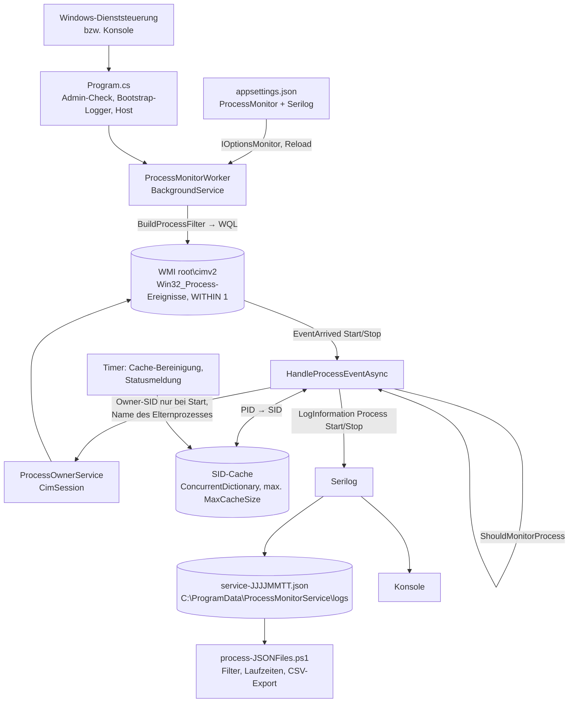
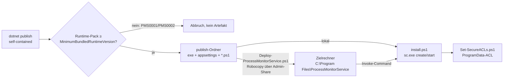
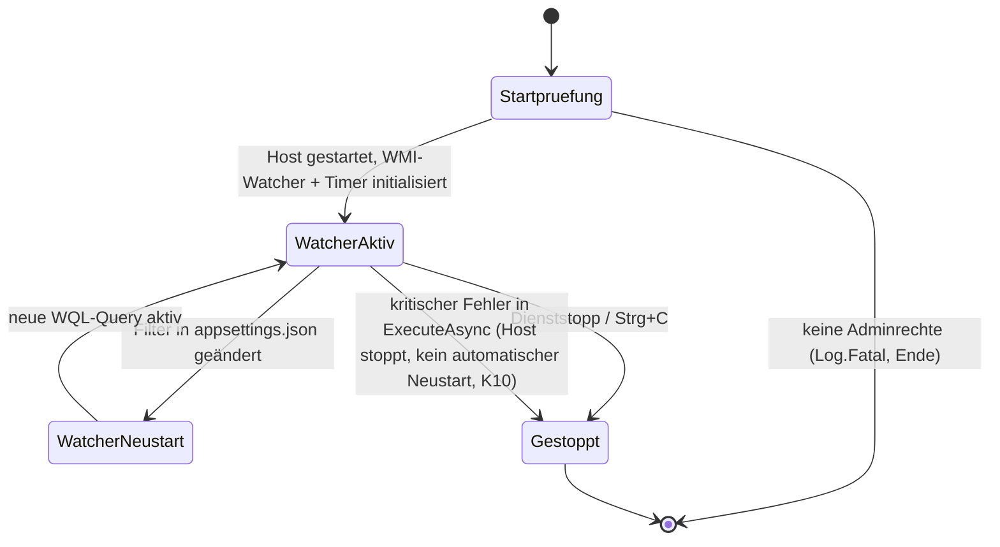

# Architektur-Übersicht – ProcessMonitorService

ProcessMonitorService erfasst auf einem Windows-Rechner Start- und Stop-Ereignisse ausgewählter Prozesse per WMI und
schreibt sie mit Benutzer-SID, Elternprozess, Pfad und Kommandozeile als strukturiertes JSON-Log. Er läuft als
Windows-Dienst (LocalSystem) oder interaktiv als CLI-Programm (Strg+C beendet). PowerShell-Skripte installieren den
Dienst lokal oder remote und werten die Logs aus.

---

## Stack

| Schicht | Technologie |
|---------|-------------|
| Laufzeit / Host | .NET 9 Generic Host (`Microsoft.NET.Sdk.Worker`), `UseWindowsService()`, `net9.0-windows` |
| Ereignisquelle | WMI (`System.Management`: `__InstanceCreationEvent`/`__InstanceDeletionEvent` auf `Win32_Process`, `WITHIN 1`) + CIM (`Microsoft.Management.Infrastructure`) |
| Logging / Ausgabe | Serilog → Konsole + rollierende JSON-Dateien (`CompactJsonFormatter`) unter `C:\ProgramData\ProcessMonitorService\logs\` |
| Betriebsskripte | PowerShell 5.1 (Install, Uninstall, ACL, Remote-Deploy), PowerShell 7 (Log-Analyse) |
| Datenbank | keine |
| Auth | keine eigene; Windows-Identität (Dienst als LocalSystem, Adminpflicht beim Start) |
| Build | `dotnet build` / `dotnet publish -c Release -r win-x64 --self-contained true` |

---

## Scope-Grenzen — Was dieses System NICHT tut

Bewusste Negativ-Liste. Sie verhindert Scope Creep und macht
Architekturentscheidungen nachvollziehbar.

- Keine zentrale Sammlung: Logs bleiben lokal auf dem überwachten Rechner; kein Versand an SIEM, Datenbank oder Netzwerkdienst.
- Kein Eingreifen: Der Dienst beobachtet nur, er blockiert oder beendet keine Prozesse.
- Keine lückenlose Erfassung: WMI-Polling im Sekundentakt; sehr kurzlebige Prozesse können fehlen (KNOWN_ISSUES K1).
- Keine Plattformen außer Windows (WMI/CIM, Windows-Dienst, `net9.0-windows`); keine Linux-/macOS-Unterstützung.
- Keine Benutzeroberfläche und kein Netzwerk-Endpunkt (auch kein Health-Endpunkt, obwohl `AddHealthChecks()` registriert ist).

Änderungen an dieser Liste sind eine Architekturentscheidung → ADR erforderlich.

---

## Systemstruktur (Datenfluss)



Installation und Verteilung:



---

## Modul-Verantwortlichkeiten

```
Program.cs              → Composition Root: Adminprüfung, Bootstrap-Logger, Host mit Serilog und DI aufbauen
ProcessMonitorWorker    → WMI-Watcher starten/neu starten, Ereignisse filtern, SID-Cache pflegen, Ereignisse loggen
ProcessOwnerService     → CIM-Abfragen: Owner-SID eines Prozesses, Name eines Prozesses zu einer PID
ProcessMonitorOptions   → Konfigurationsmodell der Sektion ProcessMonitor (Filter, Intervalle, Cache-Grenze)
ProcessCacheEntry       → Cache-Eintrag: SID + Zeitpunkt des letzten Zugriffs
install.ps1             → Dienst lokal registrieren und starten, danach ACL-Skript ausführen
uninstall.ps1           → Dienst stoppen und entfernen
Set-SecureACLs.ps1      → Datenverzeichnis anlegen und auf Administratoren + SYSTEM beschränken
Deploy-ProcessMonitorService.ps1 → Remote: deinstallieren, Dateien kopieren, installieren
process-JSONFiles.ps1   → JSON-Logs lesen, filtern, Laufzeiten berechnen, als Tabelle/CSV/Pipeline ausgeben
```

---

## Zustandsmodell (Dienst-Lebenszyklus)



Während `WatcherNeustart` sind die alten Watcher bereits gestoppt — Ereignisse in diesem Fenster gehen verloren (K8).

---

## Entscheidungsrelevante Constraints

| Constraint | Auswirkung |
|-----------|-----------|
| WMI-Ereignisse auf `Win32_Process` brauchen Adminrechte; `GetOwnerSid` funktioniert nur für noch laufende Prozesse | Dienst läuft als LocalSystem; SID wird beim Start gecacht und beim Stop wiederverwendet |
| Intrinsische WMI-Ereignisse werden per Polling (`WITHIN 1`) erzeugt | Erfassungslücke bei kurzlebigen Prozessen; Last steigt mit der Anzahl überwachter Prozesse |
| Self-contained Deployment | Keine Runtime-Voraussetzung auf dem Zielrechner, aber Runtime-Patches nur per Neu-Build |
| Öffentliches Repository | Keine internen Hostnamen, Pfade oder Betroffenheiten in `docs/` (`docs/local/` für Interna) |
| .NET 9 STS endet am 2026-11-10 | Migration auf .NET 10 LTS (I3) |

---

## Lese-Pfad für Architektur-Details

Wenn du tiefer einsteigen willst, lies in dieser Reihenfolge — jeder Schritt
baut auf dem vorigen auf:

1. **Diese Datei** (`OVERVIEW.md`) — Big Picture, Scope-Grenzen, Datenfluss.
2. `architecture/PROJECT_LAYOUT.md` — wo welche Schicht und welcher Code liegt.
3. `architecture/CONFIGURATION.md` — wie die Anwendung konfiguriert wird.
4. `architecture/ERROR_HANDLING.md` — wie Fehler propagiert und behandelt werden.
5. `architecture/ADR/` — historische Architekturentscheidungen (bisher nur die Vorlage `ADR-000-template.md`).
6. **Stack-spezifische Architektur-Docs:** `architecture/CSHARP_PROJECT.md` (Ist-Layout, Zielbild),
   `architecture/DEPENDENCIES.md` (Pakete, Runtime), `architecture/REMOTE_EXECUTION.md` (Remote-Deployment, aus dem
   Stack `powershell-automation` übernommen).
7. Features: `features/PROCESS_MONITORING.md` (Dienst), `features/LOG_ANALYSIS.md` (Auswertungsskript).

`architecture/DOMAIN_MODEL.md` gibt es bewusst nicht: Die fachlichen Regeln (Filterlogik, SID-Cache) sind klein und
stehen in `features/PROCESS_MONITORING.md`.

Begriffe und Geschäftssprache: `docs/GLOSSARY.md`.
Bekannte Einschränkungen und Probleme: `docs/KNOWN_ISSUES.md`.
