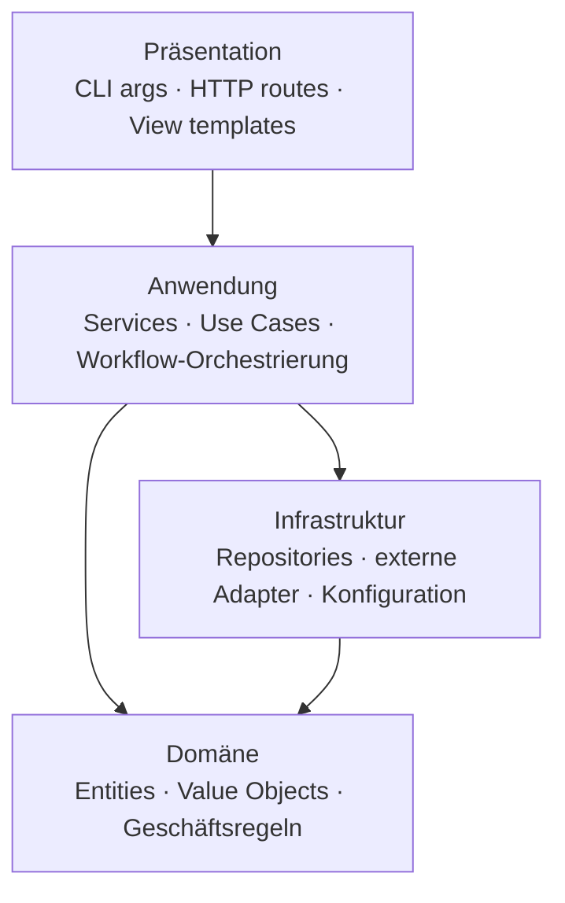

# Projekt-Layout – ProcessMonitorService

Empfohlene Ordnerstruktur und Schichten-Modell. Stack-spezifische Architektur-Docs
(z. B. `architecture/CSHARP_PROJECT.md`, `RUST_PROJECT.md`, `PYTHON_WEB_PROJECT.md`,
`REACT_PROJECT.md`, `ASPNET_PROJECT.md`) präzisieren diese Vorgabe; base zeigt das
sprach-agnostische Skelett, die Regeln und den Schichtregel-Check.

Verbindet sich mit den Prinzipien [[SEPARATION_OF_CONCERNS]] und [[ORTHOGONALITY]].

---

## Projektbezug (Stand 2026-10-11)

ProcessMonitorService ist ein **einzelnes .NET-Projekt im Repo-Root** ohne physische Schichtentrennung; die logische
Zuordnung der Typen zu den Schichten unten steht in `architecture/CSHARP_PROJECT.md`. Das sprach-agnostische Skelett
ist hier Zielrichtung, kein Ist-Zustand. Ein ausführbarer Schichtregel-Check (Abschnitt unten) lohnt sich erst, wenn
es mehr als ein Projekt bzw. eigene Schicht-Ordner gibt — bis dahin ersetzt ihn die Regel „WMI/CIM nur in
`ProcessOwnerService` bzw. hinter einer Abstraktion“ (`docs/CONVENTIONS.md` und `architecture/CSHARP_PROJECT.md`).

---

## Schichten-Modell



**Regeln für Abhängigkeiten:**

- Pfeile zeigen erlaubte Aufrufrichtung (nur nach unten / nach innen).
- Domäne hat **keine** Abhängigkeiten zu Infrastruktur (DI-Inversion: Domäne
  definiert Interfaces, Infrastruktur implementiert).
- Präsentation hat **keine** direkten Aufrufe in Domäne oder Infrastruktur —
  geht immer über Services in der Anwendungsschicht.
- **Ausnahme Composition Root:** Der Einstiegspunkt (z. B. `Program.cs`, App-Factory, `main`)
  darf alle Schichten kennen, um sie zu verdrahten (DI-Registrierung, Konfiguration). Er
  enthält keine Fachlogik; Aufrufe aus Präsentationscode laufen weiterhin über die Anwendungsschicht.

---

## Sprach-agnostisches Skelett

```
[projekt]/
├── src/                         # Quellcode (oder analog: app/, lib/, csproj/)
│   ├── presentation/            # CLI-Parser, HTTP-Routes, View-Templates
│   ├── application/             # Services, Use Cases
│   ├── domain/                  # Entities, Value Objects, Geschäftsregeln
│   └── infrastructure/          # Repositories, externe Adapter, Konfig-Loader
├── tests/
│   ├── unit/                    # Spiegelt src/-Struktur
│   └── integration/
├── docs/                        # Dieses Doku-Set
└── [build-output]/              # Stack-spezifisch: .venv/, bin/, obj/, dist/
```

> Stack-Overlays können Ordnernamen anders wählen (z.B. `Controllers/Services/Models`
> im ASP.NET-Konvention, `routes/services/models/templates` in Flask). Wichtig
> ist die **Schichten-Trennung**, nicht das exakte Ordner-Wording.

---

## Regeln

- **Eine Datei pro Modul.** Module sind nach Verantwortung benannt, nicht nach Typ.
- **Bündelung nach Feature, nicht nach technischem Layer** ist akzeptabel, wenn
  innerhalb jedes Features die Schichten klar bleiben.
- **Imports gehen nur nach unten** entlang des Schichten-Graphen — keine zyklischen
  Abhängigkeiten zwischen Schichten.
- **Domäne kennt keine Infrastruktur-Typen** (ORM-Entities, HTTP-Clients).
  Wenn die Domäne persistieren muss → Repository-Interface in der Domäne,
  Implementierung in der Infrastruktur.
- **Tests parallel zur Quellstruktur.** Eine Test-Datei pro Modul.
- **Build-Output und Caches** gehören in `.gitignore`.

---

## Schichtregel als ausführbarer Check

Ein Schichten-Diagramm, das niemand prüft, driftet — besonders, wenn Agenten Code
schreiben. Sobald das Projekt mehr als eine Schicht oder mehrere Pakete/Module hat, wird
die Abhängigkeitsregel als **Test bzw. Gate** formuliert:

- **Werkzeug je Stack** (Beispiele): Python `import-linter` (Contracts in
  `pyproject.toml`), .NET `NetArchTest`/`ArchUnitNET` als Unit-Test, PowerShell ein
  Pester-Test über den AST (`Import-Module`/Dot-Sourcing nur nach unten), Rust ein
  Check über `cargo metadata`. Eine konkrete Umsetzung liefert bisher nur rust-cli
  (`architecture/RUST_PROJECT.md`, falls vorhanden); sonst wählt das Projekt das Werkzeug und trägt es hier ein.
- **Registrierungspflicht:** Jedes Modul/Paket ist einer Schicht zugeordnet; ein
  unbekanntes Modul lässt den Check scheitern, statt durchzurutschen.
- **Der Check hat eigene Tests** (eine erlaubte und eine verbotene Beispielkante), sonst
  prüft er womöglich nichts.
- **Teil der Quality Gates** (`CONVENTIONS_COMMON.md` Abschnitt 5: läuft im selben Gate-Lauf mit, als Test in Gate 4
  oder eigener Befehl) — lokal und, falls vorhanden, in CI.

---

## Anti-Pattern

- **Business-Logik im Controller / im Template:** Routes/Views formatieren nur,
  sie entscheiden nicht.
- **Repository, das HTTP-Status zurückgibt:** Boundary-Vokabular in der
  Infrastruktur — Verstoß gegen Schichtung.
- **„Utils"-Ordner als Sammelbecken:** Funktionen ohne Schichten-Zuordnung
  sind ein Indikator, dass Verantwortung unklar ist.
- **Direkte Datenbank-Zugriffe aus mehreren Schichten:** nur Repositories
  dürfen Persistenz kennen.

---

## Pflege

Trigger (siehe `KICKOFF.md` Phase 3a): neue Schicht / Modul-Verschiebung
zwischen Schichten / neue stack-spezifische Layout-Variante → diese Datei
aktualisieren.
